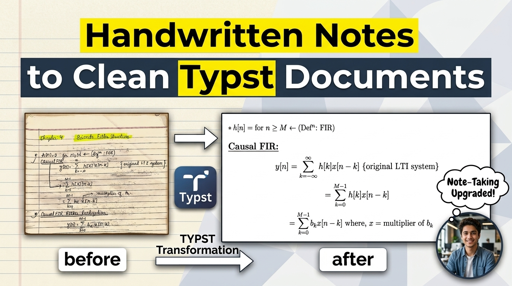

# Handwritten Notes to Clean Typst Documents

> A practical exploration of Typst for converting handwritten DSP notes into clean, modern markup—paving the way for building sleek CVs without LaTeX bloat.

---

## 💡 Overview & Motivation

The primary motive behind this project was to gain hands-on practice with **Typst**. Coming from a LaTeX background, dealing with complex package dependencies, slow compilation times, and verbose syntax felt increasingly tedious. Typst offers a refreshingly fast, modern, and intuitive alternative for typesetting structured documents and mathematical derivations.

Through transcribing handwritten notes from **Chapters 4, 5, and 6** of Digital Signal Analysis and Processing (covering Discrete Filter Structures, FIR Filter Design, and IIR Filter Design), this repository serves as a playground for mastering Typst’s math layout, custom styling, non-bordered tables, and document structures.

---

## 🎥 Walkthrough & Video Tutorial

Check out the full breakdown and walkthrough on YouTube:

[](https://www.youtube.com/watch?v=Na4_AbiCg4c)

> _Click the image above to watch the video._

---

## 🚀 Getting Started

Follow these steps to set up Typst on your machine and compile the document locally.

### 1. Prerequisites (macOS via Homebrew)

Verify Homebrew is installed, then install Typst:

```bash
# Check Homebrew version
brew --version

# Install Typst
brew install typst

# Verify Typst installation
typst --version
```

### 2. Setup & Compilation

```bash
# Create your main Typst file (if starting fresh)
touch main.typ

# Compile the document once (generates main.pdf)
typst compile main.typ

# Live preview mode (auto-recompiles on save)
typst watch main.typ
```

---

## 📚 What Was Implemented

- **Custom Grid Layouts**: Created custom headers with yellow highlights and aligned metadata.
- **Mathematical Derivations**: Expressed piecewise window functions, Bessel functions, Kaiser windows, and bilinear transformations.
- **Borderless Tables**: Styled custom math tables (e.g., Main Lobe Width and Stopband Attenuation) using zero-stroke rules and specific column alignments.
